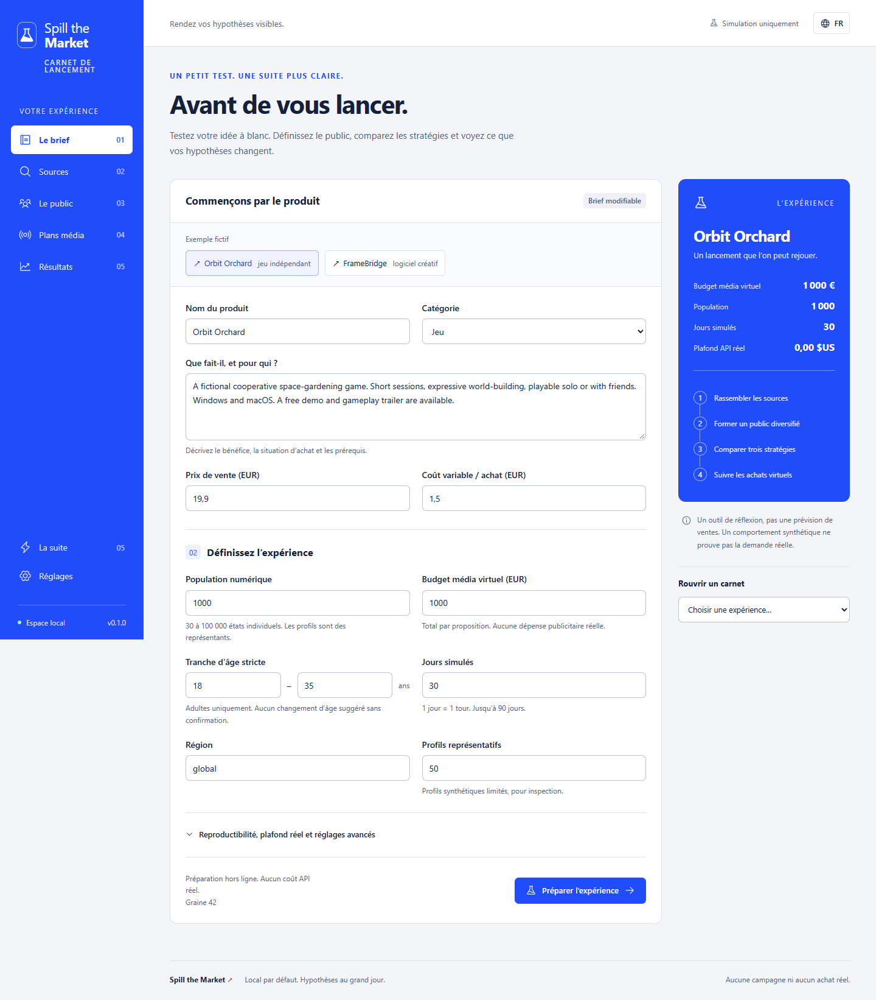

# Spill the Market

**Give your product launch a dry run.** Explore a market, build a synthetic audience, edit three launch strategies and see which assumptions change the outcome.

[Guide français](docs/README-FR.md) · [Methodology](docs/METHODOLOGY.md) · [Architecture](docs/ARCHITECTURE.md) · [Visual page module](docs/PAGE-ANALYSIS.md)



## Try it locally

Python 3.11 or 3.12 and [uv](https://docs.astral.sh/uv/) are required. Node.js and Docker are **not** required to run the included interface.

```sh
git clone https://github.com/Tit-one/spill-the-market.git
cd spill-the-market
uv run spill-market serve --open
```

Open **http://127.0.0.1:8765**. Choose the fictional game or creative-software example, prepare the brief, edit the media plans, and run. Both demos work without an API key. On Windows, `Lancer Spill the Market.cmd` starts the same application.

An installed wheel includes the interface too:

```sh
python -m venv .venv
# Activate the environment, then install a wheel from GitHub Releases:
python -m pip install /path/to/spill_the_market-0.1.0-py3-none-any.whl
spill-market serve --open
```

## From evidence to an experiment

1. **Research.** Collect public pages/RSS, import documents, or use configured Tavily search and optional Firecrawl extraction. Findings retain their source IDs, dates, collection gaps and evidence status. Optional structured AI extraction uses a bounded real-services ledger.
2. **Audience.** Choose an inclusive adult age range, means, population and representative count. Inspect fictional profiles and their source-linked beliefs. Age suggestions require confirmation; weak age-related behavior priors are editable assumptions, including a neutral setting.
3. **Media plans.** Compare three editable combinations of price, channel, creative, delivery hours and frequency under the same virtual advertising envelope. Lock individual lines. Product-specific proposals cover fifteen channel families, including in-game placements.
4. **Simulation and report.** Follow attention, watch completion, comments, sharing, trend adoption, fatigue, questions and first purchases over daily rounds. Compare against price-matched no-campaign controls, with separate exploration and validation seeds. Export JSON, CSV, standalone HTML or Markdown.

### Different channels, different mechanics

TikTok/Instagram short videos use creator/spectator events and sparse next-day earned propagation. Closed Facebook/community groups restrict membership and contacts. Rewarded videos, interstitials, search intent, streams, newsletters and other formats execute distinct attention/response rules.

Catalogue: **TikTok, Instagram, Facebook, YouTube, Twitch, in-game ads, search, display, podcasts, newsletters, affiliate, creators, communities, X and Reddit.** The catalogue's response rates and prices are illustrative model assumptions, not live platform estimates.

### Two budgets, kept separate

- **Virtual media money:** fictional advertising/commission spending inside each scenario, in the study currency.
- **Real API cap:** a user-chosen USD ceiling for external search, extraction and AI requests. Known maximum costs are reserved before dispatch. Unknown charges remain reserved after interruption. Creating or running the default demo spends nothing on these services.

Numeric people are individual NumPy states. Optional bounded LLM representatives contribute cached reactions and bounded, explicitly unvalidated response hypotheses; they never directly create sales. The numeric simulation itself makes no model calls. See [measured workloads](docs/BENCHMARKS.md) before choosing a large population.

## Optional providers

Copy `.env.example` to an ignored local file and fill only the services you choose. Enter your verified current provider prices; the application does not invent billing rates.

```sh
spill-market serve --env-file /path/to/local.env --open
```

Tavily requires `TAVILY_API_KEY` and `SPILL_TAVILY_USD_PER_CREDIT`. Firecrawl uses corresponding `FIRECRAWL_API_KEY` and `SPILL_FIRECRAWL_USD_PER_CREDIT`. Structured AI uses an OpenAI-compatible chat-completions endpoint with `SPILL_LLM_*` model, key, token-limit and pricing settings. Reasoning and token-parameter compatibility are configurable. The browser never receives your keys.

Existing MiroFish env files can be selected explicitly: recognized `LLM_*`/`NEO4J_*` variables are mapped in memory. Existing process environment wins, other variables are ignored, and no file or secret is copied into this repository. Set pricing/reasoning options in your own environment when reusing a separate configuration file.

Paid research stages and representative batches are journaled. Repeating the same request reuses committed work; an ambiguous dispatched stage requires reconciliation instead of a blind paid retry. To intentionally research new live data, create a new study/request. Original retrieval dates remain visible.

## Python and CLI

```sh
spill-market doctor
spill-market examples
spill-market study create --example game
spill-market demo --example game --population 1000 --days 30 --repetitions 10 --output report.json
spill-market simulate STUDY_ID
spill-market status RUN_ID
spill-market cancel RUN_ID
spill-market resume RUN_ID
spill-market export RUN_ID --format html --output report.html
```

`study create --spec study.json` accepts the same versioned `StudySpec` used by the interface. `simulate --plans plans.json` accepts your edited candidates. `research STUDY_ID --request request.json` uses the same research service and persistent budget as the browser.

```python
from spill_market.models import ProductSpec, AudienceSpec, StudySpec
from spill_market.media import propose_plans
from spill_market.simulation import compare_strategies

spec = StudySpec(
    product=ProductSpec(name="My game", description="A cooperative puzzle game with short sessions.",
                        category="game", unit_price_cents=1990),
    audience=AudienceSpec(population=1000, age_min=18, age_max=35),
    media_budget_cents=100_000,
)
plans = propose_plans(spec.product, spec.audience, spec.media_budget_cents)
report = compare_strategies(spec, plans)
```

## Local memory and MiroFish

SQLite FTS5 plus a source/belief graph works by default, without Zep, Neo4j, model downloads or Docker. Your existing MiroFish installation is not loaded or modified.

```sh
spill-market import-mirofish STUDY_ID /path/to/export.json
# Optional direct read-only reuse of a specific Graphiti/Neo4j namespace:
uv sync --extra graphiti
uv run spill-market import-graphiti STUDY_ID --group-id GRAPH_ID --env-file /path/to/local.env
```

The optional bridge reads a bounded namespace and imports unverified synthetic memories into the new local study. It is not the Graphiti SDK, does not write into the original graph, and does not run its extractor. [Architecture and isolation](docs/ARCHITECTURE.md).

## What the numbers mean

This is an **assumption-driven experiment**, not a validated sales forecast. Source collection does not establish representative sampling, ad prices, demographics or purchase probabilities. More simulated people and random seeds do not validate those assumptions.

The primary comparison maximizes virtual total revenue under a common media envelope. Contribution after variable costs is reported separately. Attribution is a reading rule, not evidence of causality. [Definitions, windows and limitations](docs/METHODOLOGY.md).

The first release models adults and a first purchase of one product. It does not buy ads, contact creators, process payments, model taxes/refunds or operate a real checkout.

## Next: visual product-page analysis

Planned module 5 will capture desktop/mobile pages, create a grounded multimodal observation, reveal it progressively to personas, and locate questions, rejection and friction by section. A direct-image control sample will check what the shared description loses. Browser navigation is a further extension. [Detailed contract](docs/PAGE-ANALYSIS.md).

## Develop

```sh
uv sync
uv run pytest -q
uv run ruff check src tests
cd frontend
npm ci
npm test
npm run build
cd ..
uv build
```

The frontend build writes the bundled package assets. CI exercises Python 3.11/3.12 on Windows, Linux and macOS, including an isolated wheel installation. See [verification evidence](docs/VERIFICATION.md), [contributing](CONTRIBUTING.md) and [license notices](NOTICE.md).
