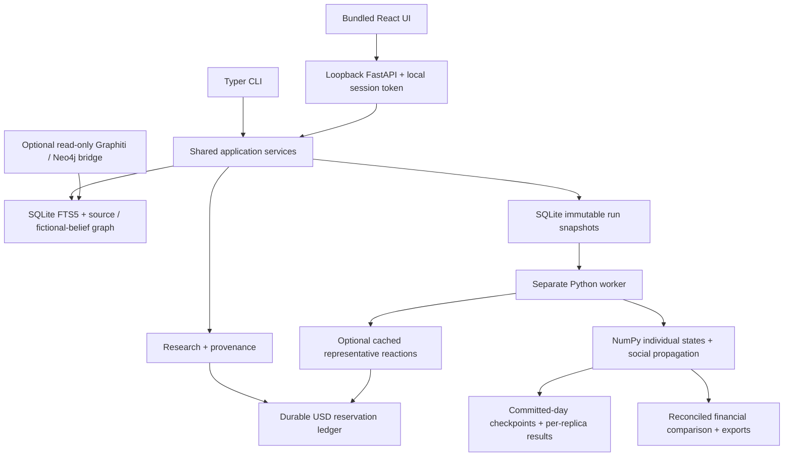

# Architecture

## Boundaries

- `models.py`: versioned Pydantic input contracts, inclusive adult ages and monetary constraints.
- `research.py`, `gateway.py`, `representatives.py`: source-bound extraction and optional external work. Actual text remains data. No external page may select tools, edit budgets or grant actions.
- `personas.py`, `media.py`, `simulation.py`, `reports.py`: native individual-based model. No provider credentials or network requests in the numeric engine.
- `storage.py`, `jobs.py`, `worker.py`: durable study/run state, real process ownership, cancellation and checkpoints. An observation timeout alone never identifies a lost worker.
- `services.py`, `api.py`, `cli.py`: common application operations, local host/origin checks, write-session token and portable reports.
- `memory.py`, `graphiti_bridge.py`: study-scoped local retrieval and optional explicitly selected read-only namespace import.

Each synthetic person has independent traits, money, exposures and acquisition state; representative counts never multiply sales. Social influence uses bounded sparse contacts, not an N×N matrix. Large populations still advance through daily rounds.

## Storage and recovery

Live files belong in the platform-local application-data directory (`SpillTheMarket`), not a synced/network filesystem. SQLite WAL serializes short transactions. Per-run snapshots capture product, audience, plans and research; later edits do not change a running experiment.

Checkpoints commit a whole simulated day atomically with a model/input fingerprint. Completed replica results stay available for resumption. Cancellation preserves committed work. Provider reservations are independent of simulation checkpoints: a failed day cannot erase already incurred/uncertain external charges.

FTS5 is lexical retrieval plus graph traversal, not a claim of semantic embedding parity. It needs no model download. Imported source statements remain unverified; simulated beliefs/results never become external market evidence.

## MiroFish and Graphiti

MiroFish is an external import source, not an imported Python dependency. Its application, processes, databases and private configuration are not modified by the default app.

JSON/CSV/SQLite exports are read without loading the MiroFish runtime. The optional `graphiti` extra installs only the Neo4j driver. Fixed parameterized queries read a user-selected `group_id`, scope both relationship endpoints and omit invalidated facts. Imported memories are marked unverified and synthetic in the new local study.

This is not full Graphiti SDK integration, cloud Zep, or the Graphiti extraction/reranking pipeline. Keeping it outside the core avoids forcing OASIS's historical dependency versions into a lightweight local application.

## Packaging

Vite writes precompiled assets under `src/spill_market/web`. The Python wheel includes them and FastAPI serves them. Node is a development/build dependency. Python 3.11 and 3.12 are the initial support matrix. CI builds and installs the wheel on Windows, Linux and macOS; actual results are recorded separately from local verification.

## Future visual module

`PageAuditSpec` reserves a contract for the approved page-analysis extension. It has no enabled v0.1 audit endpoint. [Observation, persona exposure and vision-control contracts](PAGE-ANALYSIS.md).
