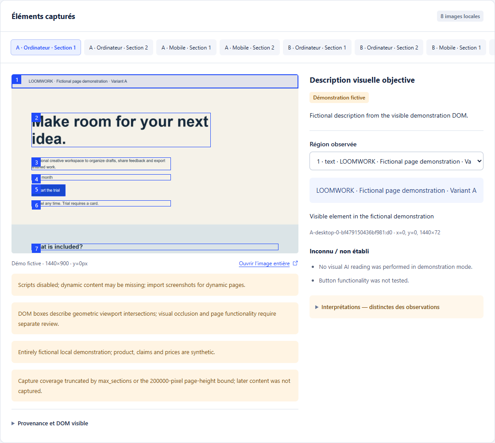

# Module 5 — visual product-page comprehension

Implemented for v0.2, independently from numerical acquisition simulation. The page report produces synthetic comprehension hypotheses; it does not automatically change sales probabilities.



## Data flow

`PageAuditSpec -> PageSnapshot -> GroundedObservation -> PersonaPageReview -> PageAuditReport -> funnel hypotheses`

1. Accept a public URL, uploaded HTML or user-selected screenshots. Snapshot stores content hash, capture time, viewport, scroll offset and navigation history. Capture mobile and desktop; retain above-the-fold separately. Local HTML is untrusted and never executes in the application origin.
2. Multimodal observer records visible text, elements, coordinates, section IDs, prices, buttons and absent/unknown information. DOM/accessibility text is evidence alongside images, never a substitute for seeing the image. Separate exact observations, uncertain OCR and interpretations.
3. An exposure scheduler reveals only the current viewport/section to each persona. Hidden prices, full-page summaries and auditor recommendations must not leak into a first impression. Preserve the advertisement that led to the visit.
4. Personas produce current understanding, questions, confidence, sought information, proposed next action, friction and conditional buying intention. Age is one configurable hypothesis alongside ability, familiarity, need and means.
5. A stratified control sample sees the actual images directly, compared with personas using structured observations. This measures information lost or added by the shared observer; it does not establish real-user validity.
6. Report each issue against the exact screenshot/section and persona context. Pair A/B page variants with the same initial personas, advertisements and random streams. Proposed friction coefficients remain hypotheses until calibrated with observed user behavior.

## Integration contracts

- `PageSnapshot`: id/hash, source, viewport, scroll position, image reference, visible DOM, capture metadata.
- `GroundedObservation`: regions with bounding boxes, literal observations, evidence references, uncertainty; no global judgment embedded in neutral descriptions.
- `PersonaPageReview`: persona_id, snapshot_id, visible_information_ids, understanding, questions, reaction, intended_action, intention_before/after, provenance.
- `PageAuditReport`: paired versions, audience coverage, findings by section/persona, direct-vision control results, recommended experiments, limitations and real inference receipts.
- The acquisition engine receives versioned, editable friction/trust hypotheses. Page audit does not directly invent sales.

## Cost and execution boundaries

All vision calls use the same real-services ledger, token/image limits and uncertain-charge rules. Raw images/HTML stay local until the user explicitly selects a remote provider. Local vision providers remain an option. Reuse factual observations across personas while retaining representative direct-image checks.

A later browser-agent extension verifies navigation and interactive behavior for a bounded subset. Visual reading alone cannot prove a working checkout, accessibility flow, valid purchase, actual conversion rate or real-person comprehension.

## Running the module

Install Chromium once with `uv run python -m playwright install chromium`. On Linux use `--with-deps` when required. The bundled Playwright driver does not require a separately installed Node runtime. Image import does not require Chromium.

Use the Page tab after preparing a study. Capture is a local, unpaid operation. URL captures deliberately disable scripts; missing resources, dynamic-content limits, missing imported viewports and section truncation remain visible in snapshot warnings. HTML imports have no script/network access. A static snapshot is not functional navigation.

Choose a configured visual model only after inspecting captures. `configured` reuses the explicitly selected `SPILL_LLM_*` configuration unless overridden by `SPILL_VISION_*`. Required visual settings are `SPILL_VISION_ENABLED=true`, known input/output USD prices and `SPILL_VISION_MAX_IMAGE_INPUT_TOKENS`. Input/output ceilings and image liability must be configured for the chosen model. Unknown prices or insufficient budgets prevent dispatch. The same study ledger covers research and page inference; a zero-budget study cannot make remote model requests.

The optional local profile uses `SPILL_VISION_LOCAL_URL` (loopback only) and `SPILL_VISION_LOCAL_MODEL`. Its responses must support the same image and structured-JSON contracts; no paid-provider fallback occurs.

An application-data `provider-profile.json` may contain an explicitly selected `env_file` reference and allowlisted `public_settings`. It must not contain API keys or passwords. The CLI reads the reference in memory; existing environment values and an explicit `--env-file` take precedence. Source configuration files are not changed or copied.

The selected existing GPT-6 Luna model supports image input and structured output in Chat Completions. Standard input/output rates were checked on 8 November 2026 at USD0.10/USD0.50 per million tokens; these remain configurable public settings, not an assumed tariff for another provider or processing tier. [Model contract](https://developers.openai.com/api/docs/models/gpt-6-luna), [pricing](https://developers.openai.com/api/docs/pricing), [image inputs](https://developers.openai.com/api/docs/guides/images-vision). Image and text usage share the bounded reservation; uncertain dispatches cannot be blindly replayed.

CLI equivalents:

```sh
spill-market page capture STUDY_ID --url https://example.com
spill-market page capture STUDY_ID --html local-page.html
spill-market page capture STUDY_ID --image screenshot.png
spill-market page capture STUDY_ID --spec paired-page-request.json
spill-market page status AUDIT_ID
spill-market page analyze AUDIT_ID --provider configured --allow-remote
spill-market page cancel AUDIT_ID
spill-market page resume AUDIT_ID
spill-market page export AUDIT_ID report.html --format html
```

The default capture without a source creates a visibly fictional page, for which `--provider demo` permits an offline pipeline demonstration. Demo analysis is rejected for real URLs/HTML/images. Sampled personas remain within the study's strict adult age range; reports disclose uncovered age bands and viewports. Neither sample size nor age grouping validates real-user behavior.
